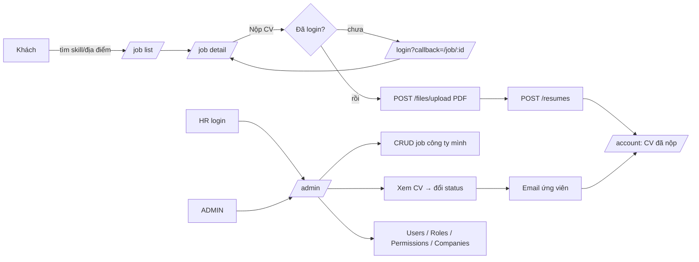
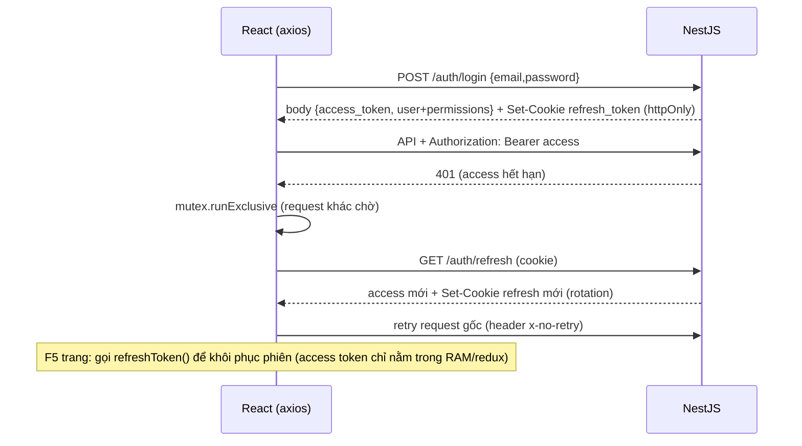

# PLAN — Website tuyển dụng việc làm IT ("ITJobs")

## 1. Mục tiêu & phạm vi

Website kết nối **ứng viên IT** với **nhà tuyển dụng (HR của công ty)**, có trang quản trị phân quyền động.

| Vai trò (role) | Làm được gì |
|---|---|
| Khách (chưa đăng nhập) | Xem/tìm việc theo skill, địa điểm, level; xem danh sách & chi tiết công ty |
| `NORMAL_USER` (ứng viên) | Đăng ký/đăng nhập, nộp CV (PDF) vào job, xem trạng thái các CV đã nộp, nhận email khi CV đổi trạng thái |
| `HR` (gắn với 1 công ty) | Vào trang Admin: CRUD job **của công ty mình**, xem & đổi trạng thái CV nộp vào công ty mình |
| `ADMIN` | Toàn quyền: users, roles, permissions, companies, jobs, resumes |

**Ngoài phạm vi (YAGNI, thêm khi có yêu cầu):** quên mật khẩu, đăng nhập Google, subscriber nhận job qua email theo cron, dashboard thống kê, chat, thanh toán đăng tin, upload lên S3/R2 thật (chỉ chừa interface).

## 2. Giả định

- Node 22, npm 10. MongoDB local (`mongodb://localhost:27017/itjobs`) hoặc Atlas.
- Dev: BE chạy `http://localhost:8000`, FE chạy `http://localhost:5173`, **Vite proxy** `/api` và `/images` sang BE → cùng origin, cookie `httpOnly` hoạt động không cần CORS. Production đặt sau 1 reverse proxy cùng domain.
- Email dev: dùng Mailpit / Ethereal (SMTP). Gửi mail lỗi **không** được làm hỏng nghiệp vụ (chỉ log).

### Backend dependencies (NestJS 11 – bản mới nhất từ `@nestjs/cli`)
```bash
npx @nestjs/cli@latest new backend --package-manager npm --strict --skip-git
cd backend
npm i @nestjs/config @nestjs/mongoose mongoose@^8 class-validator class-transformer \
  @nestjs/passport passport passport-local passport-jwt @nestjs/jwt cookie-parser helmet bcryptjs@^3 \
  @nestjs/swagger swagger-ui-express nodemailer handlebars
npm i -D @types/passport-local @types/passport-jwt @types/cookie-parser @types/multer @types/nodemailer @swc/cli @swc/core
```
- CẤM: `soft-delete-plugin-mongoose`, `dotenv`, `@types/bcryptjs`, `@nestjs-modules/mailer` (dùng thẳng `nodemailer` + `handlebars`, ~20 dòng), `ms` (thời hạn token cấu hình bằng **giây**).
- `mongoose` pin `^8` (khớp peer của `@nestjs/mongoose` 11, type `FilterQuery`).
- Multer có sẵn trong `@nestjs/platform-express`.

### Frontend dependencies
```bash
npm create vite@latest frontend -- --template react-swc-ts
cd frontend
npm i antd@^5 @ant-design/pro-components@^2 @ant-design/icons @ant-design/v5-patch-for-react-19 \
  react-router @reduxjs/toolkit react-redux axios async-mutex dayjs react-quill-new dompurify
npm i -D sass-embedded
```
- React 19 → bắt buộc `import '@ant-design/v5-patch-for-react-19'` đầu `main.tsx`.
- `antd` giữ **v5**. CẤM `react-quill`, `uuid`, `dotenv`, `@types/react-router-dom`.
- `dompurify` (v3, có sẵn types): **bắt buộc** sanitize HTML mô tả job/công ty trước khi render ở trang client (HR nhập rich text → chống XSS).
- Không cài `lodash` (chưa có chỗ cần).

## 3. Kiến trúc

### Backend
```
backend/
├─ .env.example
├─ nest-cli.json                 # builder swc cho dev, assets: mail/templates/**/*
├─ public/images/{company,resume}/   # file upload (gitignore nội dung)
└─ src/
   ├─ main.ts
   ├─ app.module.ts
   ├─ core/
   │  ├─ transform.interceptor.ts
   │  ├─ base.schema.ts
   │  ├─ soft-delete.plugin.ts
   │  └─ paginate.ts             # PaginationQueryDto + paginate() + escapeRegex()
   ├─ decorator/customize.ts     # @Public @SkipPermission @ResponseMessage @User + IUser
   ├─ auth/
   │  ├─ auth.module.ts / auth.controller.ts / auth.service.ts
   │  ├─ local.strategy.ts / local-auth.guard.ts
   │  ├─ jwt.strategy.ts / jwt-auth.guard.ts (+ hasPermission)
   │  ├─ jwt-auth.guard.spec.ts
   │  └─ dto/register.dto.ts
   ├─ users/        (controller, service, module, dto/, schemas/user.schema.ts)
   ├─ roles/        (…, schemas/role.schema.ts — export ADMIN_ROLE, HR_ROLE, USER_ROLE)
   ├─ permissions/  (…, schemas/permission.schema.ts)
   ├─ companies/    (…)
   ├─ jobs/         (…)
   ├─ resumes/      (…)
   ├─ files/        files.module.ts, files.controller.ts, storage.service.ts
   ├─ mail/         mail.module.ts, mail.service.ts, templates/resume-status.hbs
   └─ databases/    databases.module.ts, databases.service.ts, seed-data.ts
```

### Frontend
```
frontend/
├─ vite.config.ts                # proxy /api, /images → http://localhost:8000
└─ src/
   ├─ main.tsx                   # patch React19, Provider, ConfigProvider(vi_VN), RouterProvider, injectStore
   ├─ router.tsx
   ├─ config/
   │  ├─ axios-customize.ts      # instance + interceptors + refreshToken() (async-mutex)
   │  ├─ api.ts                  # mọi hàm callXxx
   │  └─ constants.ts            # ALL_PERMISSIONS, SKILLS, LOCATIONS, LEVELS, RESUME_STATUS
   ├─ redux/ store.ts, hooks.ts, slice/accountSlice.ts
   ├─ types/backend.d.ts         # ambient types: IBackendRes, IModelPaginate, IUser, IJob…
   ├─ components/
   │  ├─ share/ ProtectedRoute.tsx, Access.tsx
   │  └─ client/ Header.tsx, Footer.tsx, JobCard.tsx, SearchBar.tsx (+ *.module.scss)
   ├─ layouts/ ClientLayout.tsx, AdminLayout.tsx
   └─ pages/
      ├─ auth/ Login.tsx, Register.tsx
      ├─ client/ Home.tsx, JobList.tsx, JobDetail.tsx, CompanyList.tsx, CompanyDetail.tsx, Account.tsx
      └─ admin/ Permission.tsx, Role.tsx, User.tsx, Company.tsx, Job.tsx, Resume.tsx
```

### Quy ước chung (reviewer sẽ check)
- Prefix `api/v1`. Response thành công luôn `{ statusCode, message, data }` (TransformInterceptor). Lỗi dùng exception mặc định của Nest.
- Mọi list có phân trang trả `data = { meta: { current, pageSize, pages, total }, result }`.
- Mọi input đi qua DTO + `ValidationPipe({ whitelist: true, transform: true, transformOptions: { enableImplicitConversion: true } })`. Query boolean (`isActive`) dùng `@Transform(({ value }) => value === 'true')`.
- Filter list do **từng service tự build từ field trong Query DTO** (không spread query thô vào Mongo). Text search dùng `{ $regex: escapeRegex(v), $options: 'i' }`.
- `:id` validate bằng `ParseObjectIdPipe` của `@nestjs/mongoose` (nếu bản cài không có thì `isValidObjectId` → `BadRequestException`).
- Xoá = soft delete qua `softDelete()` helper; không gọi `deleteOne`.
- Audit: create set `createdBy`, update set `updatedBy`, delete set `deletedBy` = `{ _id, email }` của `@User()`.
- Không trả `password`, `refreshToken` ra ngoài (`select: false` trên schema).

## 4. Flow





**RBAC guard (global `JwtAuthGuard`):** `@Public` → cho qua. Không có/invalid JWT → 401. `@SkipPermission` → chỉ cần đăng nhập. Còn lại: `user.permissions` (lấy từ role trong `JwtStrategy.validate`) phải có phần tử `method === req.method && apiPath === req.route.path` → không có thì 403.

## 5. Data model

Tất cả schema `@Schema({ timestamps: true })` và `extends BaseSchema` (`createdBy`, `updatedBy`, `deletedBy`: `{ _id, email }`; `isDeleted` default false; `deletedAt`; `createdAt`, `updatedAt`). Unique index dùng `partialFilterExpression: { isDeleted: false }` để bản ghi đã xoá mềm không chặn tạo lại.

| Collection | Field | Ghi chú |
|---|---|---|
| `permissions` | `name`, `apiPath` (vd `/api/v1/jobs/:id`), `method` (GET/POST/PATCH/DELETE), `module` (USERS/ROLES/PERMISSIONS/COMPANIES/JOBS/RESUMES) | unique `(apiPath, method)` |
| `roles` | `name` (unique, UPPERCASE), `description?`, `isActive` (default true), `permissions: ObjectId[] → Permission` | |
| `users` | `name`, `email` (unique, lowercase), `password` (bcrypt, select:false), `role: ObjectId → Role`, `company?: ObjectId → Company` (bắt buộc với HR), `refreshToken?` (sha256 của token, select:false) | |
| `companies` | `name`, `address`, `description` (HTML), `logo` (url `/images/company/...`) | |
| `jobs` | `name`, `skills: string[]` (UPPERCASE), `company: ObjectId → Company`, `location`, `salary: number`, `quantity: number`, `level` (INTERN/FRESHER/JUNIOR/MIDDLE/SENIOR), `description` (HTML), `startDate`, `endDate`, `isActive` (default true) | index `{ skills: 1 }`, `{ company: 1 }` |
| `resumes` | `email`, `user: ObjectId → User`, `url` (`/images/resume/...`), `status` (PENDING/REVIEWING/APPROVED/REJECTED, default PENDING), `company: ObjectId → Company`, `job: ObjectId → Job`, `history: [{ status, updatedAt, updatedBy: {_id,email} }]` | |

Quan hệ: Role N–N Permission; User N–1 Role; HR N–1 Company; Job N–1 Company; Resume N–1 User/Job/Company.

## 6. API Specs (prefix `/api/v1`)

Quyền: **P** = `@Public`, **L** = `@SkipPermission` (chỉ cần login), **R** = RBAC theo bảng permissions. Cột "Seed role" = role được gán permission đó trong seed (ADMIN luôn có tất cả **R**).

| Method | Path | Quyền | Seed role | Mô tả |
|---|---|---|---|---|
| POST | /auth/login | P | | LocalAuthGuard; trả `{access_token, user}` + cookie |
| POST | /auth/register | P | | tạo user role NORMAL_USER |
| GET | /auth/refresh | P | | đọc cookie, rotation, trả như login |
| POST | /auth/logout | L | | xoá refreshToken DB + clear cookie |
| POST | /files/upload | L | | multipart `file` + body `folder` (company\|resume) → `{ url }` |
| GET/POST | /users | R | | list (query name,email) / tạo |
| PATCH/DELETE | /users/:id | R | | |
| GET/POST | /roles | R | | list / tạo |
| PATCH/DELETE | /roles/:id | R | | |
| GET/POST | /permissions | R | | list (query name,apiPath,method,module) / tạo |
| PATCH/DELETE | /permissions/:id | R | | |
| GET | /companies, /companies/:id | P | | list (query name,address) / chi tiết |
| POST | /companies | R | | |
| PATCH/DELETE | /companies/:id | R | | |
| GET | /jobs | P | | chỉ job `isActive` & `endDate >= now`; query name, skills (CSV), location, level, company |
| GET | /jobs/manage | R | HR | tất cả job (HR: chỉ công ty mình); query như trên + isActive |
| GET | /jobs/:id | P | | populate company |
| POST | /jobs | R | HR | HR: company = user.company |
| PATCH/DELETE | /jobs/:id | R | HR | HR: chỉ job công ty mình |
| POST | /resumes | R | NORMAL_USER | `{ url, job }` |
| GET | /resumes/me | L | | CV của user hiện tại |
| GET | /resumes | R | HR | query status, job; HR: chỉ công ty mình |
| PATCH | /resumes/:id | R | HR | `{ status }` → push history + gửi mail |
| DELETE | /resumes/:id | R | | |

Lưu ý thứ tự route: khai báo `@Get('manage')` / `@Get('me')` **trước** `@Get(':id')`.

---

## 7. Tasks

### Backend Core & Setup

- [x] **T1: Khởi tạo backend + core**
  - Files: `backend/**` (scaffold), `backend/.env.example`, `backend/nest-cli.json`, `backend/.gitignore`, `src/main.ts`, `src/app.module.ts`, `src/core/transform.interceptor.ts`, `src/core/base.schema.ts`, `src/core/soft-delete.plugin.ts`, `src/core/paginate.ts`, `src/decorator/customize.ts`
  - Làm:
    - Scaffold + cài deps đúng mục 2. Xoá `app.controller.ts`, `app.service.ts`, `app.controller.spec.ts` (và `test/` e2e nếu phụ thuộc chúng).
    - `package.json` scripts: `start:dev` = `nest start -b swc -w`; `build` giữ `nest build` (tsc, để type-check).
    - `nest-cli.json`: `compilerOptions.assets: [{ "include": "mail/templates/**/*", "watchAssets": true }]`, `deleteOutDir: true`.
    - `.env.example`: `PORT=8000`, `NODE_ENV=development`, `MONGODB_URI`, `JWT_ACCESS_SECRET`, `JWT_ACCESS_EXPIRE=900`, `JWT_REFRESH_SECRET`, `JWT_REFRESH_EXPIRE=604800` (giây), `SHOULD_INIT=true`, `ADMIN_EMAIL`, `ADMIN_PASSWORD`, `MAIL_HOST`, `MAIL_PORT`, `MAIL_USER`, `MAIL_PASSWORD`, `MAIL_FROM`. `.gitignore` thêm `.env`, `public/images/*`.
    - `main.ts`: `NestFactory.create<NestExpressApplication>`; `setGlobalPrefix('api/v1')`; `helmet()`; `cookieParser()`; global `ValidationPipe` (option ở mục Quy ước); global `TransformInterceptor` (inject `Reflector`); `useStaticAssets(join(__dirname, '..', 'public'))` → URL `/images/...`; Swagger tại `/swagger` có `addBearerAuth()`; listen `PORT`. (Nếu Swagger UI bị CSP của helmet chặn: `helmet({ contentSecurityPolicy: NODE_ENV === 'production' ? undefined : false })`.)
    - `app.module.ts`: `ConfigModule.forRoot({ isGlobal: true })`; `MongooseModule.forRootAsync` lấy `MONGODB_URI`, `connectionFactory: (conn) => { conn.plugin(softDeletePlugin); return conn; }`.
    - `transform.interceptor.ts`: map → `{ statusCode: res.statusCode, message: reflector.get(RESPONSE_MESSAGE, handler) ?? '', data }`.
    - `base.schema.ts`: class `BaseSchema` với các `@Prop` audit như mục 5 (`createdAt/updatedAt` chỉ khai báo type, do timestamps sinh).
    - `soft-delete.plugin.ts` (~15 dòng): `softDeletePlugin(schema)` gắn `pre(['find','findOne','findOneAndUpdate','countDocuments','updateOne','updateMany'])` → nếu filter chưa có key `isDeleted` thì `this.where({ isDeleted: { $ne: true } })`; export `softDelete(model, id, user)` = `updateOne({ _id: id }, { isDeleted: true, deletedAt: new Date(), deletedBy: { _id, email } })`, `matchedCount === 0` → `NotFoundException`.
    - `paginate.ts`: `PaginationQueryDto` (`current` default 1 `@Min(1)`, `pageSize` default 10 `@Min(1) @Max(100)`, `sort?` `@Matches(/^-?[\w.]+$/)`); `escapeRegex(s)`; `paginate(model, filter, query, populate?)` chạy song song `countDocuments` + `find().sort(sort ?? '-createdAt').skip().limit().populate()` → `{ meta: { current, pageSize, pages, total }, result }`.
    - `customize.ts`: `IS_PUBLIC_KEY`/`Public()`, `SKIP_PERMISSION_KEY`/`SkipPermission()`, `RESPONSE_MESSAGE`/`ResponseMessage(msg)`, `User()` (createParamDecorator → `req.user`), `interface IUser { _id: string; name: string; email: string; role: { _id: string; name: string }; company?: string; permissions?: { method: string; apiPath: string }[] }`.
  - Tiêu chí đạt: `npm run build` pass; `npm run start:dev` kết nối Mongo không lỗi; `/swagger` mở được; không còn file sample của scaffold; plugin soft-delete không dùng thư viện ngoài.

- [ ] **T2: Module permissions + roles**
  - Files: `src/permissions/**`, `src/roles/**`, `src/app.module.ts`
  - Làm:
    - `Permission` schema + DTO `CreatePermissionDto` (`name`, `apiPath` `@Matches(/^\/api\/v1\//)`, `method` `@IsIn(['GET','POST','PATCH','DELETE'])`, `module` `@IsString`), `UpdatePermissionDto = PartialType(...)` (từ `@nestjs/swagger`), `QueryPermissionDto extends PaginationQueryDto` (name, apiPath, method, module).
    - `Role` schema; export `ADMIN_ROLE='ADMIN'`, `HR_ROLE='HR'`, `USER_ROLE='NORMAL_USER'` trong `role.schema.ts`. DTO: `name` (`@Transform` toUpperCase), `description?`, `isActive?`, `permissions` `@IsMongoId({ each: true })`. Query: name.
    - Controller: `GET /` (paginate), `POST /`, `PATCH /:id`, `DELETE /:id`, mỗi handler có `@ResponseMessage`, `@ApiTags`. Service ghi audit.
    - `RolesService.findOneWithPermissions(id)`: role `isActive` + populate `permissions` (select `name apiPath method module`); export service cho Auth dùng. `findByName(name)`.
    - Chặn xoá role `ADMIN` (`BadRequestException`). Trùng unique → trả 400 thay vì 500 (bắt lỗi code `11000` trong service).
  - Tiêu chí đạt: build pass; CRUD gọi được qua Swagger (tạm thời chưa có guard); list trả đúng format phân trang; xoá là soft delete và bản ghi đã xoá không xuất hiện trong list.

- [ ] **T3: Module users**
  - Files: `src/users/**`, `src/app.module.ts`
  - Làm:
    - `User` schema như mục 5 (`password`, `refreshToken` `select: false`; email lowercase + unique partial index).
    - DTO: `CreateUserDto` (`name`, `email` `@IsEmail`, `password` `@MinLength(6)`, `role` `@IsMongoId`, `company?` `@IsMongoId`), `UpdateUserDto = PartialType(OmitType(CreateUserDto, ['password']))`, `QueryUserDto` (name, email).
    - Service: hash bằng `bcryptjs` (`hash(pw, 10)`); `findByEmailWithPassword(email)` (`+password`, populate role `name`); `findById`; `setRefreshToken(id, hash|null)`; `findByIdWithRefreshToken(id)`; list populate `role` (name) & `company` (name). Nếu role được chọn là HR mà thiếu `company` → 400. Chặn xoá user có role ADMIN. Trùng email → 400.
    - Controller: `GET /`, `POST /`, `PATCH /:id`, `DELETE /:id`; response không bao giờ chứa password.
    - Export `UsersService`.
  - Tiêu chí đạt: build pass; tạo user lưu password đã hash; GET list không lộ password/refreshToken.

- [ ] **T4: Auth (Local + JWT + Refresh cookie + Dynamic RBAC guard)**
  - Files: `src/auth/**`, `src/app.module.ts`, `src/main.ts` (nếu cần)
  - Làm:
    - `AuthModule` import `UsersModule`, `RolesModule`, `PassportModule`, `JwtModule.registerAsync` (secret `JWT_ACCESS_SECRET`, `expiresIn: Number(JWT_ACCESS_EXPIRE)`). Đăng ký `JwtAuthGuard` làm `APP_GUARD`.
    - `LocalStrategy` (`usernameField: 'email'`): `bcrypt.compare`; sai → `UnauthorizedException('Email hoặc mật khẩu không đúng')`.
    - `JwtStrategy`: lấy token từ Bearer header; `validate(payload)` → `rolesService.findOneWithPermissions(payload.role._id)` → trả `IUser` kèm `permissions` (role inactive/không tồn tại → permissions rỗng). Gắn comment `// ponytail: 1 query role/request, cache theo roleId nếu tải cao`.
    - `jwt-auth.guard.ts`: export hàm thuần `hasPermission(user, method, path)`; `canActivate` cho qua nếu `@Public`; `handleRequest(err, user, info, ctx)`: không user → 401; `@SkipPermission` → trả user; còn lại so `req.method` + `req.route.path` bằng `hasPermission`, sai → `ForbiddenException`.
    - `jwt-auth.guard.spec.ts`: test `hasPermission` (khớp đúng method+path → true; sai method → false; path `/api/v1/jobs/:id` ≠ `/api/v1/jobs` → false).
    - `AuthService`: private `issueTokens(user, res)`: payload `{ sub, email, name, role: {_id,name}, company }` ký access; refresh token ký `JWT_REFRESH_SECRET` + `expiresIn: JWT_REFRESH_EXPIRE`, lưu **sha256** (`node:crypto`) vào user, set cookie `refresh_token` (`httpOnly`, `sameSite: 'strict'`, `secure: NODE_ENV === 'production'`, `path: '/api/v1/auth'`, `maxAge: JWT_REFRESH_EXPIRE * 1000`); trả `{ access_token, user: { _id, name, email, role, company, permissions } }`.
    - `refresh(req, res)`: không cookie / verify fail / hash không khớp DB → clear cookie + 401; khớp → `issueTokens` (rotation).
    - `register(dto)`: tạo user với role `NORMAL_USER` (`rolesService.findByName`), trả `{ _id, createdAt }`.
    - `logout(user, res)`: `setRefreshToken(null)` + `clearCookie('refresh_token', { path: '/api/v1/auth' })`.
    - Controller dùng `@Res({ passthrough: true })`; login `@Public() @UseGuards(LocalAuthGuard)`; register/refresh `@Public`; logout `@SkipPermission`.
  - Tiêu chí đạt: build pass; `npm test` pass; gọi route R không token → 401, có token nhưng thiếu permission → 403; refresh cấp token mới và token refresh cũ dùng lại → 401; cookie có cờ httpOnly.

- [ ] **T5: Seed dữ liệu (databases module)**
  - Files: `src/databases/**`, `src/app.module.ts`
  - Làm:
    - `seed-data.ts`: mảng `INIT_PERMISSIONS` đúng toàn bộ các dòng **R** ở mục 6 (`name` tiếng Việt, `apiPath` đầy đủ prefix `/api/v1/...`, `method`, `module`).
    - `DatabasesService implements OnModuleInit`: chạy khi `SHOULD_INIT === 'true'` **và** `permissions` đang rỗng (idempotent). Tạo permissions → roles `ADMIN` (tất cả), `HR` (các dòng có Seed role = HR), `NORMAL_USER` (`POST /api/v1/resumes`) → 1 company demo → users: admin (`ADMIN_EMAIL`/`ADMIN_PASSWORD`), `hr@itjobs.local` (HR, company demo), `user@itjobs.local` (NORMAL_USER), cùng mật khẩu `ADMIN_PASSWORD`. Log kết quả bằng `Logger`.
    - Import model trực tiếp bằng `MongooseModule.forFeature` (không cần controller).
  - Tiêu chí đạt: build pass; DB trống + `SHOULD_INIT=true` → khởi động tạo đủ dữ liệu; khởi động lại không tạo trùng; login admin gọi được mọi route R.

- [ ] **T6: Module files + mail**
  - Files: `src/files/**`, `src/mail/**`, `src/app.module.ts`
  - Làm:
    - `storage.service.ts`: `export abstract class StorageService { abstract save(file: Express.Multer.File, folder: string): Promise<string> }` + `LocalStorageService` ghi `buffer` vào `public/images/<folder>/<crypto.randomUUID()><ext>` (ext lấy theo **mimetype** map `{ 'image/jpeg': '.jpg', 'image/png': '.png', 'image/webp': '.webp', 'application/pdf': '.pdf' }`, KHÔNG dùng tên file gốc), `mkdir recursive`, trả `/images/<folder>/<file>`. Module provide `{ provide: StorageService, useClass: LocalStorageService }` (đổi sang S3/R2 chỉ cần class mới).
    - `files.controller.ts`: `POST /files/upload` `@SkipPermission`, `FileInterceptor('file')` (memory storage), `ParseFilePipe` với `MaxFileSizeValidator(5MB)` + `FileTypeValidator(/^(image\/(jpeg|png|webp)|application\/pdf)$/)`; body DTO `folder` `@IsIn(['company','resume'])`; trả `{ url }`.
    - `mail.service.ts`: `nodemailer.createTransport` từ env; `send(to, subject, template, context)` đọc `join(__dirname, 'templates', template + '.hbs')`, `Handlebars.compile`, gửi với `from: MAIL_FROM`. Lỗi → `Logger.error`, **không throw**. Export service.
    - `templates/resume-status.hbs`: thông báo `{{jobName}}` tại `{{companyName}}` đổi trạng thái thành `{{status}}`.
  - Tiêu chí đạt: build pass; `dist/mail/templates/resume-status.hbs` tồn tại sau build; upload PDF/ảnh ≤5MB trả url truy cập được qua `/images/...`; file sai type hoặc >5MB → 400; `folder` ngoài whitelist → 400.

### Backend Business Modules

- [ ] **T7: Module companies**
  - Files: `src/companies/**`, `src/app.module.ts`
  - Làm: schema như mục 5; DTO `name`, `address`, `description` (`@IsString`), `logo` (`@Matches(/^\/images\/company\//)`); Query: name, address (regex). `GET /` + `GET /:id` `@Public`; `POST`, `PATCH /:id`, `DELETE /:id` RBAC. `GET /:id` không thấy → 404. Export `CompaniesService`.
  - Tiêu chí đạt: build pass; khách xem list/chi tiết không cần token; HR gọi POST → 403.

- [ ] **T8: Module jobs**
  - Files: `src/jobs/**`, `src/app.module.ts`
  - Làm:
    - Schema như mục 5. DTO: `name`, `skills` (`@ArrayNotEmpty @IsString({each})`, Transform UPPERCASE), `company?` `@IsMongoId`, `location`, `salary` `@Min(0)`, `quantity` `@Min(1)`, `level` `@IsIn(LEVELS)`, `description`, `startDate`/`endDate` `@Type(() => Date) @IsDate`, `isActive?`. `UpdateJobDto = PartialType`.
    - `QueryJobDto extends PaginationQueryDto`: `name?` (regex), `skills?` (CSV → `@Transform` thành mảng UPPERCASE → `{ $in }`), `location?`, `level?`, `company?` `@IsMongoId`, `isActive?` (chỉ dùng ở manage).
    - Service: helper nội bộ `scope(user)` → `user.role.name === HR_ROLE ? { company: user.company } : {}`.
      - `findPublic(q)`: filter + `isActive: true, endDate: { $gte: new Date() }`, populate company `name logo`.
      - `findManage(q, user)`: filter + scope.
      - `findOne(id)`: populate company `name logo address`; 404 nếu không có.
      - `create(dto, user)`: HR → `company = user.company`; ADMIN thiếu `company` → 400; `endDate <= startDate` → 400.
      - `update`/`remove`: điều kiện `{ _id, ...scope(user) }`, không match → 404 (HR không sửa được job công ty khác). HR không được đổi `company`.
  - Tiêu chí đạt: build pass; `GET /jobs?skills=react,nodejs&location=HANOI` lọc đúng và ẩn job hết hạn/inactive; HR chỉ thấy/sửa/xoá job công ty mình.

- [ ] **T9: Module resumes (+ gửi mail khi đổi trạng thái)**
  - Files: `src/resumes/**`, `src/app.module.ts`
  - Làm:
    - Schema như mục 5. `CreateResumeDto { url @Matches(/^\/images\/resume\/.+\.pdf$/), job @IsMongoId }`; `UpdateResumeStatusDto { status @IsIn(RESUME_STATUS) }`; `QueryResumeDto` (status, job).
    - `create(dto, user)`: lấy job (phải active & còn hạn, không → 400); `company` lấy từ job (KHÔNG nhận từ client); user đã nộp job này rồi → 400; `email/user` từ `@User()`; `history = [{ status: 'PENDING', updatedAt, updatedBy }]`.
    - `findMine(user)`: `find({ user: user._id })` sort `-createdAt`, populate job `name`, company `name logo` (không phân trang).
    - `findAll(q, user)`: paginate + scope HR như jobs, populate job `name`, company `name`.
    - `updateStatus(id, dto, user)`: `findOneAndUpdate({ _id, ...scope }, { status, updatedBy, $push: { history } }, { new: true })` populate job/company; 404 nếu không có; gọi `mailService.send(resume.email, ..., 'resume-status', {...})` **không await chặn lỗi** (service mail đã tự catch).
    - `remove`: softDelete.
  - Tiêu chí đạt: build pass; ứng viên nộp CV được 1 lần/job; HR công ty khác không thấy/không đổi được CV; đổi status ghi thêm 1 phần tử `history` và gửi mail (mail lỗi vẫn trả 200).

### Frontend Base & Layout

- [ ] **T10: Khởi tạo frontend + Redux + Axios mutex**
  - Files: `frontend/**` (scaffold), `vite.config.ts`, `src/main.tsx`, `src/router.tsx`, `src/config/axios-customize.ts`, `src/config/api.ts`, `src/config/constants.ts`, `src/redux/store.ts`, `src/redux/hooks.ts`, `src/redux/slice/accountSlice.ts`, `src/types/backend.d.ts`
  - Làm:
    - Scaffold + deps mục 2; xoá `App.tsx`, `App.css`, asset demo.
    - `vite.config.ts`: `server.proxy` `/api` & `/images` → `http://localhost:8000`.
    - `backend.d.ts` (ambient, không import/export): `IBackendRes<T> { statusCode; message: string | string[]; data?: T }`, `IModelPaginate<T> { meta: {current,pageSize,pages,total}; result: T[] }`, `IPermission`, `IRole`, `IUser`, `ICompany`, `IJob`, `IResume`, `IAccount { _id; name; email; role: {_id,name}; company?: string; permissions: IPermission[] }`, `ILoginRes { access_token; user: IAccount }`.
    - `accountSlice`: state `{ isLoading: true, isAuthenticated: false, accessToken: null, user: null }`; actions `setLogin(ILoginRes)`, `setLogout()` (cả hai đặt `isLoading = false`).
    - `axios-customize.ts`: `instance` `baseURL: '/api/v1'`, `withCredentials: true`; `injectStore(store)` (tránh import vòng); request interceptor gắn `Authorization: Bearer`; response interceptor trả `res.data`.
      - `export async function refreshToken()`: ghi lại token cũ → `mutex.runExclusive`: nếu token trong store đã khác token cũ (request khác vừa refresh xong) → trả luôn; ngược lại gọi `GET /auth/refresh` (header `x-no-retry`) → `setLogin` → trả token; lỗi → `setLogout`, trả `null`.
      - Lỗi 401 và request chưa có `x-no-retry` và không phải `/auth/login` → `await refreshToken()` → có token: set header + `x-no-retry`, `return instance(config)`; không: reject. Các lỗi khác: `Promise.reject(error.response?.data ?? error)`.
    - `api.ts`: `callLogin`, `callRegister`, `callLogout` (các task sau thêm hàm vào đây).
    - `constants.ts`: `ALL_PERMISSIONS` (mirror đúng seed: `{ JOBS: { GET_MANAGE: { method, apiPath, module }, CREATE, UPDATE, DELETE }, ... }`), `SKILLS`, `LOCATIONS` (`[{ value: 'HANOI', label: 'Hà Nội' }, ...]`), `LEVELS`, `RESUME_STATUS` (value/label/color).
    - `main.tsx`: import patch React 19 đầu file, `ConfigProvider locale={viVN}` + `dayjs.locale('vi')`, `<Provider store>`, `injectStore(store)`, gọi `refreshToken()` 1 lần khi app khởi động để khôi phục phiên, `<RouterProvider>`.
    - `router.tsx` (`createBrowserRouter` từ `react-router`): khai báo đủ route mục Kiến trúc, tạm trỏ tới component placeholder `<div>` cho trang chưa làm.
  - Tiêu chí đạt: `npm run build` pass; không lưu access token vào localStorage; 3 request 401 đồng thời chỉ gây **1** lần gọi `/auth/refresh` (mutex + so token cũ).

- [ ] **T11: Client layout + Login/Register**
  - Files: `src/layouts/ClientLayout.tsx`, `src/components/client/Header.tsx`, `src/components/client/Footer.tsx`, `src/components/client/*.module.scss`, `src/pages/auth/Login.tsx`, `src/pages/auth/Register.tsx`, `src/router.tsx`
  - Làm:
    - `ClientLayout`: Header + `<Outlet/>` + Footer, responsive (Header gập menu thành Drawer ở mobile).
    - `Header`: logo → `/`, menu "Việc làm" (`/job`), "Công ty" (`/company`); chưa login: nút Đăng nhập/Đăng ký; đã login: Avatar + Dropdown ("Tài khoản" → `/account`, "Trang quản trị" → `/admin` nếu role ≠ NORMAL_USER, "Đăng xuất" → `callLogout` + `setLogout` + về `/`).
    - `Login`: antd `Form` (email, password) → `callLogin` → `setLogin` → điều hướng `?callback` nếu có, nếu không: role ≠ NORMAL_USER → `/admin`, ngược lại `/`. Đã login mà vào `/login` → redirect `/`. Lỗi → `message.error`.
    - `Register`: name, email, password, confirm (rule khớp) → `callRegister` → thông báo + chuyển `/login`.
  - Tiêu chí đạt: build pass; login/logout/register chạy với BE thật; F5 sau khi login vẫn giữ phiên (qua refresh cookie).

- [ ] **T12: Admin layout + ProtectedRoute + Access**
  - Files: `src/layouts/AdminLayout.tsx`, `src/components/share/ProtectedRoute.tsx`, `src/components/share/Access.tsx`, `src/router.tsx`
  - Làm:
    - `ProtectedRoute({ admin?, children })`: `isLoading` → `Spin` toàn trang; chưa login → `<Navigate to={'/login?callback=' + pathname}>`; `admin && role.name === 'NORMAL_USER'` → `Result 403`.
    - `Access({ permission, hideChildren?, children })`: có permission (`method` + `apiPath` khớp trong `user.permissions`) → render children; không có → `hideChildren ? null : <Result status="403" />`.
    - `AdminLayout`: `ProLayout` (`@ant-design/pro-components`) layout `mix`, menu: Công ty, Việc làm, CV ứng tuyển, Người dùng, Vai trò, Quyền hạn — mỗi item chỉ hiện khi user có ít nhất 1 permission cùng `module`; `menuItemRender` dùng `Link`; breadcrumb tự sinh; `avatarProps` (tên user) + dropdown "Về trang chủ", "Đăng xuất". Route `/admin` index hiển thị lời chào.
    - Gắn `/admin/*` vào `<ProtectedRoute admin>`, `/account` vào `<ProtectedRoute>`. Thêm route `*` → `Result 404`.
  - Tiêu chí đạt: build pass; NORMAL_USER vào `/admin` thấy 403; HR chỉ thấy menu Việc làm + CV ứng tuyển; ADMIN thấy đủ.

### Frontend Business Pages

> Quy ước trang admin: `ProTable` với `request` gọi API paginate (map `params.current/pageSize` + filter từ `search`, trả `{ data: res.data.result, total: res.data.meta.total, success: true }`), `actionRef.current?.reload()` sau khi thêm/sửa/xoá; tạo/sửa bằng 1 `ModalForm`/`DrawerForm` dùng chung (có `initialValues` khi sửa); xoá bằng `Popconfirm`; nút Thêm/Sửa/Xoá bọc `<Access permission hideChildren>`; cả trang bọc `<Access permission={...GET list...}>`. Không tạo redux slice cho dữ liệu admin.

- [ ] **T13: Admin Permissions + Roles**
  - Files: `src/pages/admin/Permission.tsx`, `src/pages/admin/Role.tsx`, `src/config/api.ts`, `src/router.tsx`
  - Làm:
    - Permission: cột name, apiPath, method (Tag màu), module, createdAt; search name/apiPath/method/module; form `ProFormText` name/apiPath, `ProFormSelect` method/module.
    - Role: cột name, description, isActive (Tag), createdAt; form name, description, `ProFormSwitch` isActive, và danh sách permission (gọi `GET /permissions?pageSize=100`) nhóm theo `module` bằng `Collapse` + `Checkbox.Group` (giá trị là mảng `_id`).
    - `api.ts`: `callFetchPermissions/Create/Update/Delete`, `callFetchRoles/Create/Update/Delete`.
  - Tiêu chí đạt: build pass; tạo role gán permission rồi user role đó login lại thấy quyền mới có hiệu lực.

- [ ] **T14: Admin Users**
  - Files: `src/pages/admin/User.tsx`, `src/config/api.ts`, `src/router.tsx`
  - Làm: cột name, email, role.name, company.name, createdAt; search name/email. Form: name, email, password (chỉ khi tạo), `ProFormSelect` role (request `callFetchRoles`), `ProFormSelect` company (request `callFetchCompanies`, chỉ hiện & bắt buộc khi role được chọn là HR — dùng `ProFormDependency`). `api.ts` thêm `callFetchUsers/Create/Update/Delete`, `callFetchCompanies`.
  - Tiêu chí đạt: build pass; tạo HR không chọn company bị chặn ở form; sửa user không gửi password.

- [ ] **T15: Admin Companies**
  - Files: `src/pages/admin/Company.tsx`, `src/config/api.ts`, `src/router.tsx`
  - Làm: cột logo (Avatar), name, address, createdAt; search name/address. `DrawerForm` rộng: name, address, logo (antd `Upload` `listType="picture-card"`, `customRequest` → `callUploadFile(file, 'company')`, chỉ ảnh, 1 file), description bằng `ReactQuill` (`react-quill-new` + `react-quill-new/dist/quill.snow.css`) trong `ProForm.Item`. `api.ts` thêm `callUploadFile(file, folder)` (FormData), `callCreate/Update/DeleteCompany`.
  - Tiêu chí đạt: build pass; upload logo hiển thị preview và lưu đúng url `/images/company/...`; sửa giữ nguyên nội dung description cũ.

- [ ] **T16: Admin Jobs**
  - Files: `src/pages/admin/Job.tsx`, `src/config/api.ts`, `src/router.tsx`
  - Làm: ProTable gọi `GET /jobs/manage`; cột name, company.name, skills (Tag), location, level, salary (format `toLocaleString('vi-VN')` + đ), endDate, isActive; search name, location, level, isActive. `DrawerForm`: name, skills (`ProFormSelect mode="tags"` options `SKILLS`), company (`ProFormSelect`, **ẩn với HR**), location, level, salary, quantity, `ProFormDateRangePicker` → startDate/endDate (dayjs), isActive, description `ReactQuill`. `api.ts` thêm `callFetchJobsManage`, `callCreate/Update/DeleteJob`.
  - Tiêu chí đạt: build pass; HR tạo job không cần chọn company và chỉ thấy job công ty mình; ADMIN bắt buộc chọn company.

- [ ] **T17: Admin Resumes**
  - Files: `src/pages/admin/Resume.tsx`, `src/config/api.ts`, `src/router.tsx`
  - Làm: ProTable cột email, job.name, company.name, status (Tag màu theo `RESUME_STATUS`), createdAt; search status. Nút "Xem" mở `Drawer`: link mở CV (`<a href={url} target="_blank" rel="noopener noreferrer">`), `Select` đổi status + nút Lưu (`callUpdateResumeStatus`, bọc `Access`), `Timeline` lịch sử `history`. Xoá bọc Access. `api.ts` thêm `callFetchResumes`, `callUpdateResumeStatus`, `callDeleteResume`.
  - Tiêu chí đạt: build pass; đổi status cập nhật bảng + timeline; HR không thấy nút Xoá.

- [ ] **T18: Client Home + danh sách việc làm**
  - Files: `src/pages/client/Home.tsx`, `src/pages/client/JobList.tsx`, `src/components/client/JobCard.tsx`, `src/components/client/SearchBar.tsx`, `src/components/client/*.module.scss`, `src/config/api.ts`, `src/router.tsx`
  - Làm:
    - `SearchBar`: `Select mode="multiple"` skills (`SKILLS`) + `Select` location + nút Tìm → `navigate('/job?skills=REACT,NODEJS&location=HANOI')`.
    - `JobCard`: logo công ty, tên job, công ty, lương, địa điểm, skills Tag, "x ngày trước" (dayjs `relativeTime`); click → `/job/:id`.
    - `Home`: hero + SearchBar; "Việc làm mới nhất" (`GET /jobs?pageSize=6`); "Công ty nổi bật" (`GET /companies?pageSize=4`, card → `/company/:id`).
    - `JobList`: đọc `useSearchParams` (skills, location, level, current), SearchBar điền sẵn giá trị, lọc thêm level, grid `Row/Col` responsive (xs 24, md 12, lg 8) + `Pagination` cập nhật URL; `Empty` khi không có kết quả.
    - `api.ts`: `callFetchJobs(query)`, `callFetchJobById`, `callFetchCompanyById`.
  - Tiêu chí đạt: build pass; tìm kiếm phản ánh lên URL, F5 giữ kết quả; hiển thị tốt ở 375px và desktop.

- [ ] **T19: Client chi tiết job + nộp CV**
  - Files: `src/pages/client/JobDetail.tsx`, `src/config/api.ts`, `src/router.tsx`
  - Làm: thông tin job + công ty (link `/company/:id`); description render `dangerouslySetInnerHTML={{ __html: DOMPurify.sanitize(job.description) }}`. Nút "Ứng tuyển": chưa login → `navigate('/login?callback=/job/' + id)`; đã login → `Modal` với `Upload.Dragger` (accept `.pdf`, chặn > 5MB ở `beforeUpload`) → `callUploadFile(file, 'resume')` → `callCreateResume({ url, job: id })` → `message.success`. Lỗi BE (đã nộp, 403…) hiển thị message. `api.ts` thêm `callCreateResume`.
  - Tiêu chí đạt: build pass; HTML chứa `<script>`/`onerror` không thực thi; nộp lần 2 hiện lỗi "đã ứng tuyển".

- [ ] **T20: Client công ty + trang tài khoản**
  - Files: `src/pages/client/CompanyList.tsx`, `src/pages/client/CompanyDetail.tsx`, `src/pages/client/Account.tsx`, `src/config/api.ts`, `src/router.tsx`
  - Làm:
    - `CompanyList`: grid card (logo, tên, địa chỉ) + tìm theo tên + `Pagination`.
    - `CompanyDetail`: logo, tên, địa chỉ, description (DOMPurify), danh sách job đang tuyển (`GET /jobs?company=<id>`) dùng lại `JobCard`.
    - `Account` (`ProtectedRoute`): `Tabs` → "CV đã ứng tuyển": `Table` từ `GET /resumes/me` (job.name → link, company.name, status Tag, ngày nộp, link xem CV).
    - `api.ts` thêm `callFetchMyResumes`.
  - Tiêu chí đạt: build pass; ứng viên thấy status CV cập nhật sau khi HR đổi ở T17; trang công ty chỉ liệt kê job còn hạn.
