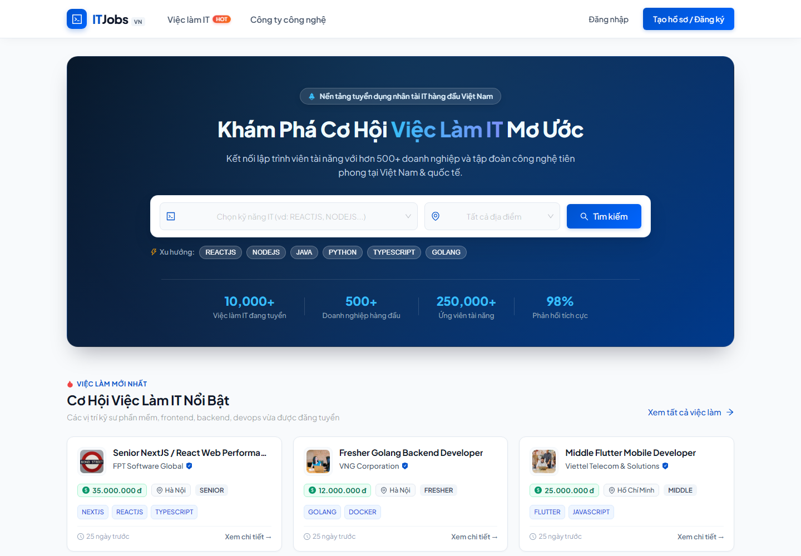
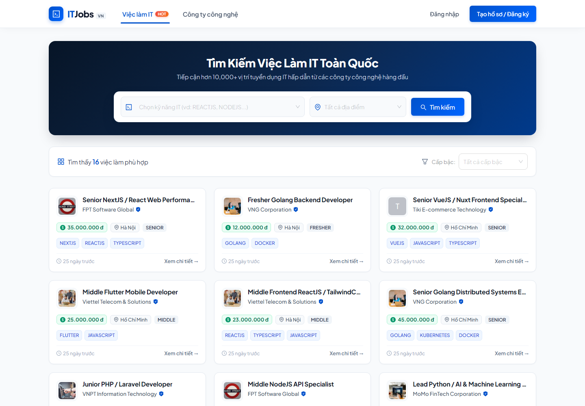
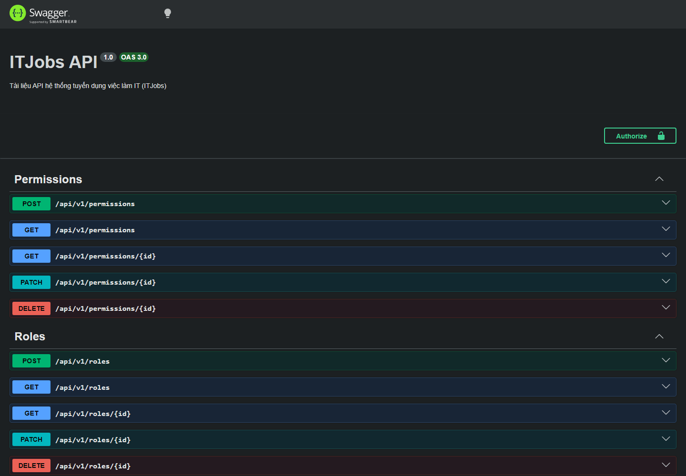
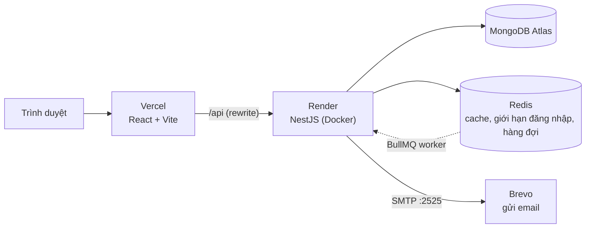

# ITJobs — Nền tảng tuyển dụng việc làm IT


Website tuyển dụng IT với ba vai trò: **ứng viên** tìm việc và nộp CV, **nhà tuyển dụng (HR)** đăng tin và duyệt hồ sơ, **quản trị viên** quản lý toàn hệ thống. Backend NestJS + MongoDB, frontend React + Ant Design, đóng gói bằng Docker và đang chạy thật trên Vercel + Render.

**Dùng thử:** [job-recruitment-tau.vercel.app](https://job-recruitment-tau.vercel.app) · **Tài liệu API:** [Swagger](https://job-recruitment-5m6p.onrender.com/swagger)

> Server Render bản miễn phí "ngủ" sau 15 phút không có người dùng, nên lần mở đầu tiên có thể mất khoảng 1 phút.

### Tài khoản demo

Đây là tài khoản **công khai** cho mục đích dùng thử, dữ liệu có thể bị thay đổi bởi người khác.

| Vai trò | Email | Mật khẩu | Làm được gì |
|---|---|---|---|
| Quản trị viên | `admin@itjobs.local` | `admin@123456` | Quản lý user, vai trò, quyền, công ty, job, hồ sơ |
| Nhà tuyển dụng | `hr@itjobs.local` | `admin@123456` | Đăng và quản lý job của công ty mình, duyệt hồ sơ |
| Ứng viên | `user@itjobs.local` | `admin@123456` | Tìm việc, nộp CV, theo dõi trạng thái |

## Hình ảnh





## Tính năng

**Ứng viên:** tìm kiếm và lọc việc theo kỹ năng, địa điểm, cấp bậc (bộ lọc đồng bộ lên URL); xem chi tiết việc làm và công ty; nộp CV dạng PDF (tối đa 5 MB, mỗi job nộp một lần); theo dõi trạng thái hồ sơ; nhận email khi trạng thái thay đổi.

**Nhà tuyển dụng (HR):** đăng, sửa, xoá tin tuyển dụng của công ty mình; xem hồ sơ ứng tuyển; đổi trạng thái hồ sơ (`PENDING` → `REVIEWING` → `APPROVED` / `REJECTED`) kèm lịch sử người đổi và thời điểm.

**Quản trị viên:** quản lý người dùng, vai trò, quyền, công ty, tin tuyển dụng và hồ sơ.

## Kiến trúc



Frontend gọi API bằng đường dẫn tương đối `/api/v1`. Vercel (và Nginx khi chạy Docker, Vite khi chạy dev) chuyển tiếp yêu cầu sang backend, nên trình duyệt chỉ thấy **một địa chỉ duy nhất**: cookie đăng nhập (`SameSite=Strict`) hoạt động bình thường và không cần cấu hình CORS.

## Điểm kỹ thuật đáng chú ý

| Chủ đề | Cách làm |
|---|---|
| **Xác thực** | JWT access token 15 phút (giữ trong Redux) và **refresh token rotation**: mỗi refresh token chỉ dùng một lần, lưu **bản băm SHA-256** trong DB, gửi qua cookie `HttpOnly` |
| **Chống đăng xuất oan** | Nhiều request cùng gặp 401 sẽ được **xếp hàng bằng mutex** ở frontend, chỉ một request đi refresh, các request còn lại dùng chung token mới |
| **Phân quyền** | **RBAC động**: quyền là cặp `(HTTP method, API path)` lưu trong DB, kiểm tra bằng guard toàn cục. HR chỉ thấy dữ liệu công ty mình |
| **Upload an toàn** | Giới hạn 5 MB, kiểm tra loại file bằng **magic number** (không tin đuôi file), danh sách thư mục cho phép chống path traversal, đặt tên file ngẫu nhiên |
| **Redis** | Cache danh sách việc làm (cache-aside, TTL 60 giây) và **khóa đăng nhập 15 phút sau 5 lần sai** (trả mã 429) |
| **Hàng đợi email** | Gửi email qua **BullMQ**: tự thử lại tối đa 5 lần với thời gian chờ tăng dần, không mất email khi máy chủ email lỗi |
| **Dữ liệu** | Soft delete và các trường kiểm toán (`createdBy`, `updatedBy`, `deletedBy`) cho toàn hệ thống |
| **Đóng gói** | Docker multi-stage cho backend và frontend (Nginx), `docker compose` chạy cả hệ thống |
| **CI/CD** | GitHub Actions chạy test và build mỗi lần push; Render chỉ deploy khi CI thành công |

## Chạy bằng Docker (nhanh nhất)

Chỉ cần cài [Docker Desktop](https://www.docker.com/products/docker-desktop/).

```bash
git clone https://github.com/HiruDuce/job-recruitment.git
cd job-recruitment
cp backend/.env.example backend/.env
docker compose up -d --build
```

| Địa chỉ | Là gì |
|---|---|
| http://localhost:3000 | Website |
| http://localhost:8000/swagger | Tài liệu API |
| http://localhost:8025 | Mailpit: hộp thư giả, xem email hệ thống gửi ra |

Lần chạy đầu, hệ thống tự tạo dữ liệu mẫu (3 tài khoản ở trên, 7 công ty, 20 việc làm).

Nếu sau khi build lại, trang báo lỗi 502, chạy `docker compose restart frontend`.

## Chạy không dùng Docker

Cần Node.js 22, MongoDB và Redis đang chạy trên máy.

```bash
# Backend
cd backend
cp .env.example .env
npm install
npm run start:dev        # http://localhost:8000

# Frontend (mở terminal khác)
cd frontend
npm install
npm run dev              # http://localhost:5173
```

Muốn xem email khi phát triển, chạy thêm Mailpit: `docker run -p 1025:1025 -p 8025:8025 axllent/mailpit`.

## Cấu trúc thư mục

```
job-recruitment/
├── backend/             NestJS: auth, users, roles, permissions, companies, jobs, resumes, files, mail
├── frontend/            React + Vite: components, layouts, pages, redux, config (axios)
├── docs/images/         Ảnh minh họa cho README
├── .github/workflows/   CI (GitHub Actions)
├── docker-compose.yml   mongo, redis, mailpit, backend, frontend
└── README.md
```

## Kiểm thử

Backend có bộ test cho hàm kiểm tra quyền (`npm test` trong `backend/`). CI chạy test và build cho cả backend lẫn frontend ở mỗi lần push và mỗi Pull Request.

## Triển khai

| Thành phần | Dịch vụ |
|---|---|
| Frontend | Vercel (`frontend/vercel.json` chuyển tiếp `/api` sang backend) |
| Backend | Render, build từ `backend/Dockerfile` |
| Cơ sở dữ liệu | MongoDB Atlas |
| Redis | Render Key Value (chính sách bộ nhớ `noeviction` cho hàng đợi) |
| Email | Brevo SMTP qua cổng 2525 (Render gói miễn phí chặn cổng 25, 465, 587) |

## Hạn chế đã biết

- **File upload lưu trên ổ đĩa của server**: trên Render miễn phí, CV và logo đã tải lên sẽ mất khi deploy lại. Hướng cải thiện: chuyển sang dịch vụ lưu file như Cloudinary.
- **Mỗi người dùng chỉ có một phiên đăng nhập**: DB lưu một refresh token cho mỗi người dùng, nên đăng nhập thiết bị mới sẽ làm thiết bị cũ phải đăng nhập lại. Chưa phát hiện việc refresh token bị dùng lại.
- **Khi Redis ngừng hoạt động**, hệ thống vẫn chạy nhưng danh sách việc làm và đăng nhập chậm đi nhiều giây trước khi rơi về MongoDB. Hướng cải thiện: cho lệnh cache bỏ cuộc ngay khi mất kết nối.
- **Độ phủ test còn thấp**: mới có test cho hàm kiểm tra quyền.
- Email trên bản demo gửi từ địa chỉ Gmail qua Brevo nên có thể hiện tên miền của Brevo và dễ vào thư mục Spam. Cần tên miền riêng để xác thực đầy đủ.

## Về quá trình phát triển

Dự án được làm cùng các công cụ AI (Claude, Antigravity) để viết và review code. Tôi đã đọc, chạy thử và có thể giải thích các phần chính: luồng xác thực và refresh token, phân quyền, hàng đợi email, Docker và CI/CD.

## Tác giả

**Phùng Đức Hiếu** · [GitHub](https://github.com/HiruDuce) · hieuphung180805@gmail.com
